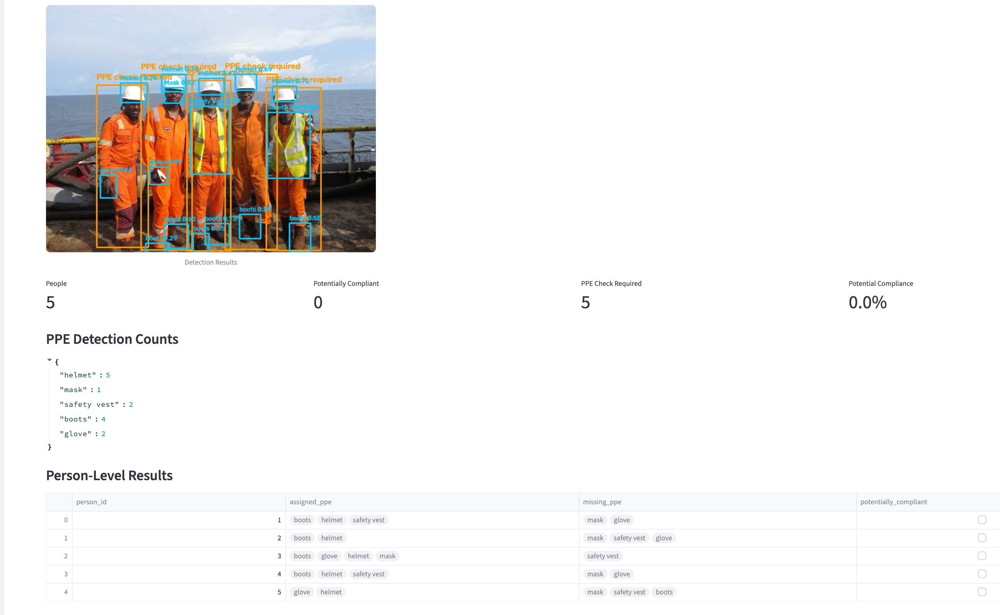

# PPE Compliance Monitor

A computer vision application for detecting Personal Protective Equipment (PPE) and monitoring potential PPE compliance using YOLOv8, OpenCV, and Streamlit.

The application detects people and PPE items in uploaded images and videos, associates detected PPE with people using approximate bounding-box geometry, and generates visual and analytical results.

## Features

- **Person Detection:** Detect people using pretrained YOLOv8n.
- **PPE Detection:** Detect helmets, masks, safety vests, boots, and gloves using a custom-trained YOLOv8 model.
- **Image Analysis:** Upload images and visualize detection results.
- **Video Analysis:** Process uploaded videos and generate annotated output.
- **Compliance Analytics:** Estimate missing PPE categories for each detected person.
- **Interactive Dashboard:** View detection counts, compliance metrics, and frame-level statistics.
- **Configurable Detection:** Adjust confidence thresholds and required PPE categories.

## System Architecture

```text
                 Input Image / Video
                         |
                         v
                 Image Preprocessing
                         |
                         v
                +------------------+
                |   YOLOv8 Models  |
                +------------------+
                   /            \
                  v              v
          Person Detection   PPE Detection
                  \              /
                   v            v
                 Detection Results
                         |
                         v
              PPE-to-Person Association
                  (Geometry Heuristic)
                         |
                         v
                 Compliance Analytics
                         |
                         v
                 Visualization Layer
                         |
                         v
                  Streamlit Dashboard
```
## Results



## Models

### 1. Person Detection

- Model: YOLOv8n
- Source: Ultralytics pretrained COCO model
- Purpose: Detect people in images and video frames.

### 2. PPE Detection

- Architecture: YOLOv8
- Training framework: Ultralytics
- Custom-trained model hosted on Hugging Face.

**Model repository:** [ZubairAli25266/ppe_detector](https://huggingface.co/ZubairAli25266/ppe_detector)

**Model weights:** `best.pt`

### Detected Classes

| Class | Description |
|---|---|
| Helmet | Safety helmet |
| Mask | Protective mask |
| Safety Vest | High-visibility safety vest |
| boots | Safety boots |
| glove | Protective gloves |

## Model Evaluation

The following results were obtained on the held-out test set.

- Test images: 1,177
- Test instances: 3,751
- Model parameters: 3,133,679
- GFLOPs: 8.6
- Training epochs: 30

### Overall Performance

| Metric | Score |
|---|---:|
| Precision | 86.49% |
| Recall | 74.49% |
| mAP@50 | 82.29% |
| mAP@50–95 | 47.89% |

### Class-wise Performance

| Class | Precision | Recall | mAP@50 | mAP@50–95 |
|---|---:|---:|---:|---:|
| Helmet | 90.0% | 74.6% | 80.5% | 47.8% |
| Mask | 88.9% | 83.8% | 89.8% | 52.2% |
| Safety Vest | 88.1% | 71.8% | 80.9% | 51.7% |
| boots | 79.8% | 74.2% | 82.2% | 47.4% |
| glove | 85.6% | 68.0% | 78.1% | 40.4% |

## Project Structure

```text
ppe-compliance-monitor/
│
├── src/
│   ├── __init__.py
│   ├── preprocessing.py
│   ├── inference.py
│   ├── analytics.py
│   ├── visualization.py
│   └── video_processing.py
│
├── app.py
├── requirements.txt
└── README.md
```

## Installation

### 1. Clone the repository

```bash
git clone https://github.com/YOUR_USERNAME/ppe-compliance-monitor.git
cd ppe-compliance-monitor
```

### 2. Create a virtual environment

```bash
python -m venv venv
```

Activate it:

**Windows**
```bash
venv\Scripts\activate
```

**Linux / macOS**
```bash
source venv/bin/activate
```

### 3. Install dependencies

```bash
pip install -r requirements.txt
```

## Run the Application

Start the Streamlit application:

```bash
streamlit run app.py
```

Open the local URL displayed in your terminal.

## Usage

1. Open the Streamlit application.
2. Upload an image or video.
3. Configure the confidence threshold.
4. Select the PPE categories that should be required.
5. Run detection.
6. Inspect annotated detections and analytics.

## Compliance Analysis

The application uses bounding-box geometry to estimate whether detected PPE items belong to a detected person.

It checks approximate body regions:

- Helmet: Head region
- Mask: Face region
- Safety vest: Upper body region
- Boots: Lower body region
- Gloves: Arm and hand region

Each detected person receives an estimated status:

- **Potentially compliant:** All selected PPE categories were associated with the person.
- **PPE check required:** At least one selected PPE category was not associated with the person.

These labels represent heuristic estimates, not verified safety compliance.

## Limitations

- PPE-to-person association uses approximate bounding-box geometry.
- The PPE detector identifies PPE objects; it does not independently verify that a person is wearing them.
- Occlusion, camera angle, object overlap, and detection errors can affect results.
- Video statistics are frame-level, not unique-worker statistics.
- Worker tracking is not currently implemented.
- The application processes uploaded images and videos; continuous browser webcam monitoring requires additional camera integration.

## Future Improvements

- Integrate object tracking using ByteTrack.
- Improve PPE-to-person association using pose estimation or more advanced spatial reasoning.
- Add worker-level compliance tracking.
- Support continuous browser webcam monitoring.
- Add event logging and historical analytics.
- Optimize inference for real-time deployment.

## Tech Stack

| Technology | Purpose |
|---|---|
| Python | Core programming |
| PyTorch | Deep learning framework |
| Ultralytics YOLOv8 | Object detection |
| OpenCV | Image and video processing |
| NumPy | Numerical operations |
| Pandas | Analytics and tabular results |
| Streamlit | Interactive application |
| Hugging Face Hub | Model hosting and retrieval |
